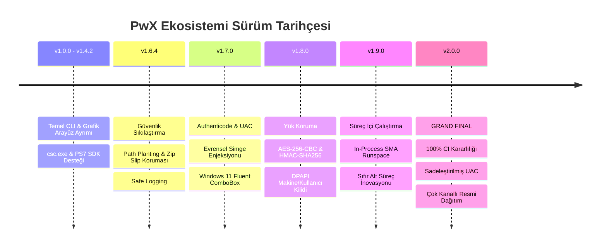

# 🏛️ PwX Ekosistemi — v2.0.0 Grand Final Tarihçesi ve Mühendislik Günlüğü
> **"Sıfır Dış Bağımlılık, Tamamen Çevrimdışı ve Yerel Güç: PowerShell'den Windows Yürütülebilir Dosyalarına Kesintisiz Geçiş."**  
> *Geliştirici: Tahir Yılmaz (@mtahiryilmazz) & Antigravity (Google DeepMind)*  
> *Tarih: 27 Ekim 2026*  
> *Sürüm: v2.0.0 Grand Final Major Release*

---

## 🧭 1. Giriş ve Projenin Doğuşu

PowerShell betiklerinin (`.ps1`) kurumsal ortamlarda ve son kullanıcı makinelerinde dağıtılması her zaman belirli zorluklarla karşılaşmıştır:
1. `ExecutionPolicy` engelleri ve kullanıcıların konsol ortamından çekinmesi,
2. Üçüncü taraf dönüştürücülerin (ps2exe vb.) güvenilmez harici paket bağımlılıkları ve çevrimdışı (air-gapped) ortamlarda çalışamaması,
3. Antivirüs ve EDR yazılımlarının şeffaf olmayan veya geçici dizinlere komut dosyası fırlatan dönüştürücülere şüpheli gözle bakması,
4. PowerShell 5.1 ile modern PowerShell 7.4+ arasındaki mimari ve çalışma zamanı uçurumu.

**PwX Studio** ve çekirdek derleme motoru **pwxe**, bu problemleri kökten çözmek için yola çıktı. Temel ilke en baştan belirlendi:
> **"Hiçbir üçüncü taraf modüle ihtiyaç duymadan, Windows'un kendi yerleşik derleyicisi (`csc.exe`) ve resmi Microsoft SDK'ları ile %100 çevrimdışı, bağımsız ve güvenilir yerel Windows ikili dosyaları (`.exe`) üretmek."**

---

## 🗺️ 2. Kilometre Taşları ve Yol Haritası Gelişimi

### v1.0.0 — Çekirdek Mimari ve Bağımsız Motor
* `pwxe` CLI ve PowerShell modülü olarak ayrıştırıldı.
* Çift hedef motoru kuruldu:
  * **PowerShell 5.1:** Windows yerleşik Roslyn `csc.exe` ile 500 KB'lık bağımsız C# host.
  * **PowerShell 7.4+:** `.NET 8 SDK` ve `Microsoft.PowerShell.SDK` ile modern dil özellikleri.

### v1.6.4 — Kurumsal Güvenlik Sıkılaştırması
* **Arama Yolu Güvenliği (Search Path Planting):** CWD, Downloads ve Desktop aramaları engellendi.
* **Zip Slip Zafiyet Önleme:** Çıkarma işlemlerinde dizin dışına taşma denetimi.
* **İzole Hata Günlüğü:** Güvenlik açıklarını engellemek amacıyla `PWX_ERROR_LOG` yönlendirmesi üretim ikililerinde derleme şartına bağlandı.

### v1.7.0 — Kod İmzalama, UAC ve Evrensel İkon
* **Authenticode Kod İmzalama:** Windows Sertifika Deposu (Thumbprint) veya PFX ile RFC 3161 zaman damgalı otomatik imzalama.
* **UAC Manifest Denetimi:** `app.manifest` üzerinden yönetici izinlerinin PE seviyesinde yapılandırılması.
* **Evrensel Pencere Simgesi Enjeksiyonu:** Hem WinForms (`System.Drawing.Icon`) hem WPF (`BitmapFrame`) pencerelerini çalışma zamanında dinamik yakalayan evrensel kanca.
* **Windows 11 Fluent ComboBox:** Açık/Koyu tema renklerine dinamik uyum sağlayan şablon.

### v1.8.0 — Yük Koruma ve Donanım Kilitleme (Payload Protection & DPAPI)
* **Kriptografik Koruma:** Gömülü betiklerin düz metin olarak incelenmesini önleyen AES-256-CBC ve HMAC-SHA256 (`PWXENC01`) zarfı.
* **Windows DPAPI Donanım Kilidi:** İsteğe bağlı olarak şifreleme anahtarının mevcut makineye ve kullanıcı hesabına mühürlenmesi.

### v1.9.0 — Süreç İçi (In-Process) Runspace Devrimi
* **Sıfır Alt Süreç:** Harici `powershell.exe` başlatma zorunluluğunun ortadan kaldırılarak doğrudan bellek içinde `System.Management.Automation` Runspace açılması.
* AST tabanlı parametre aktarımı, çıkış kodları (`exit N`) ve UTF-8 sadakati.

### v2.0.0 — Grand Final Major Release (Nihai Olgunluk)
* **Sadeleştirilmiş UAC Seçimi:** Standart kullanıcı için anlaşılır Türkçe terimler ("Standart", "En Yüksek", "Tam Yetki") ve teknik ToolTip'ler.
* **UTF-8 BOM Kök Çözümü:** `PwX-Build.ps1` motorunun gömülü betiği daima UTF-8 BOM ile yazması sağlanarak Türkçe karakter kaynaklı derleme/çalışma çökmelerinin tamamen bitirilmesi.
* **%100 CI Başarısı:** GitHub Actions matrisinde tüm testlerin yeşil geçmesi.
* **Çok Kanallı Dağıtım:** PowerShell Gallery, NuGet.org ve GitHub Releases üzerinden eşzamanlı resmileşme.

---

## 🔬 3. Zorlu Mühendislik Problemleri ve Çözümleri

### 1. UTF-8 BOM ve PowerShell 5.1 Çok Baytlı Karakter Krizinin Çözümü
* **Problem:** .NET `[System.Text.UTF8Encoding]::GetBytes()` metodu UTF-8 BOM başlığını (`0xEF, 0xBB, 0xBF`) bayt dizisine eklemez. BOM olmadan yazılan betikler Windows PowerShell 5.1 tarafından Windows-1252 (ANSI) olarak okunur ve Türkçe karakterlerde/emojilerde sözdizimi hatası vererek (ExitCode 1) uygulamanın açılmadan çökmesine yol açar.
* **Çözüm:** `PwX-Build.ps1` içerisinde gömülü betiğin yazımında doğrudan UTF-8 BOM'u yazan `[IO.File]::WriteAllText($payload, $scriptContent, $script:Utf8Bom)` standardı uygulandı.

### 2. In-Process STA/MTA İş Parçacığı Ayrımı
* **Problem:** Windows Presentation Foundation (WPF) arayüzleri tek iş parçacıklı daire (Single-Threaded Apartment - STA) modunda çalışmak zorundadır. Standart C# konsol uygulamaları ise MTA modundadır.
* **Çözüm:** C# Stub içerisinde `#if PWX_GUI` koşuluyla derlenen GUI modlarında Runspace oluşturulurken `rs.ApartmentState = ApartmentState.STA` açıkça atandı.

### 3. PS5.1 [ushort] Tip Hızlandırıcısı Eksikliği
* **Problem:** Windows PowerShell 5.1 ortamında `[ushort]` tip hızlandırıcısı yerleşik olarak tanımlı değildir; çalıştırıldığında `Unable to find type [ushort]` hatası verir.
* **Çözüm:** Tip doğrudan `[uint16]` (veya `[System.UInt16]`) olarak standartlaştırıldı.

---

## 📊 4. Nihai Bütünlük ve Doğrulama Tablosu

| Bileşen | Dosya Adı | Boyut | SHA-256 Özeti |
|---|---|---|---|
| **PwX Studio GUI EXE** | `PwX-Studio-v2.0.0.exe` | 736 KB | `f27e41573a32b6441a8cd23d8b2c7ba29e0644aa2d9d38e4a6d4b012657f4d82` |
| **PwX Studio Script** | `PwX-Studio-v2.0.0.ps1` | 413 KB | `1a1eafa97faeba9a4b97cfd99fa573943b0163323dfbbfb59fe52a1c5f9b204e` |
| **pwxe NuGet Paketi** | `pwxe.2.0.0.nupkg` | 37 KB | `49f8fe65d312770c32d5b6c0ddb188c0e43884f16c63fb869e713c742eb09f14` |

---

## 🏆 5. Kapanış ve Teşekkür

PwX projesi, titiz bir mühendislik vizyonu, kesintisiz test disiplini ve mükemmellik arayışıyla tamamlanmıştır. Her satır kod, her güvenlik denetimi ve her arayüz detayı, açık kaynak PowerShell dünyasına uzun yıllar hizmet edecek kalitede tasarlanmıştır.

Bu tarihi çalışmayı gururla belgeliyor ve geleceğe bir hatıra olarak emanet ediyoruz. 🚀
