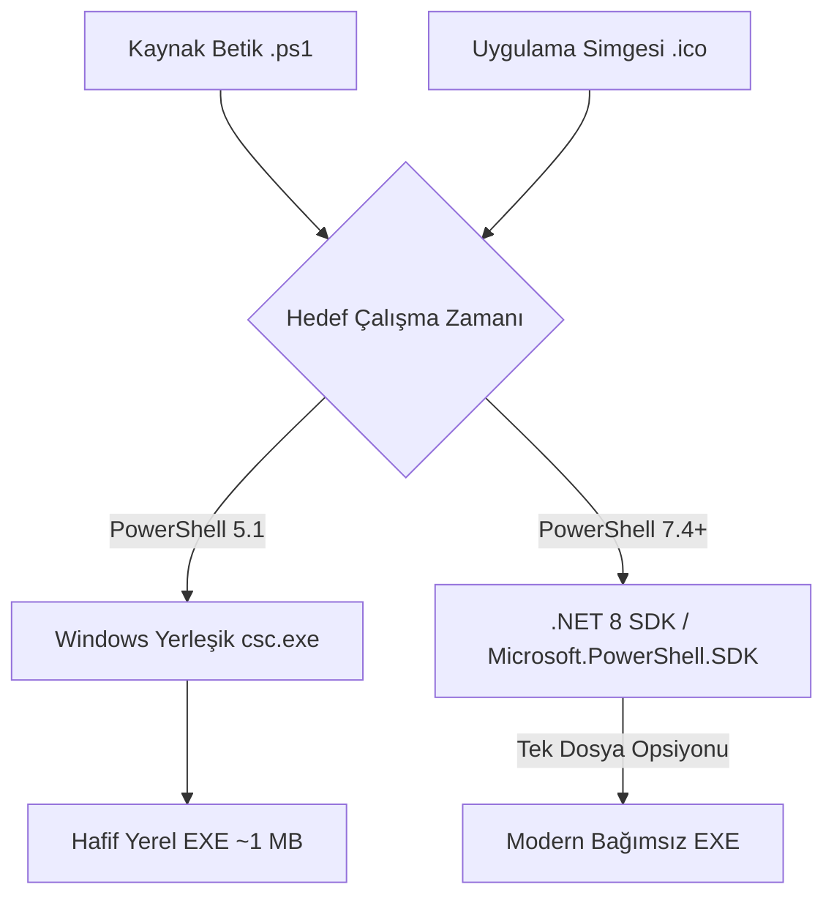

# PwX Studio

<p align="center">
  
</p>

<p align="center">
  <strong>PowerShell Script to EXE Builder — Windows GUI Application</strong><br>
  <em>PowerShell betiklerinizi sıfır dış bağımlılıkla modern, bağımsız ve yerel Windows (.exe) uygulamalarına dönüştürün.</em>
</p>

<p align="center">
  <a href="https://github.com/mtahiryilmazz/pwxstudio/releases/latest"></a>
  <a href="LICENSE"></a>
  
  
  
</p>

---

## 📖 İçindekiler

- [Hakkında](#-hakkında)
- [Temel Özellikler](#-temel-özellikler)
- [Mimari ve Dönüştürme Motoru](#-mimari-ve-dönüştürme-motoru)
- [Ekran Görüntüsü](#-ekran-görüntüsü)
- [Sistem Gereksinimleri](#-sistem-gereksinimleri)
- [Kurulum ve Çalıştırma](#-kurulum-ve-çalıştırma)
- [Kullanım Rehberi](#-kullanım-rehberi)
- [Simge (Icon) Yönetimi](#-simge-icon-yönetimi)
- [Geliştirme ve Test](#-geliştirme-ve-test)
- [Sürümler ve Değişiklikler](#-sürümler-ve-değişiklikler)
- [Lisans](#-lisans)

---

## 🌟 Hakkında

**PwX Studio**, PowerShell (`.ps1`) betiklerini tek tıklamayla bağımsız Windows çalıştırılabilir (`.exe`) dosyalarına dönüştüren modern grafik arayüzlü bir geliştirici aracıdır.

Sistem yöneticileri, DevOps mühendisleri ve Windows geliştiricileri için tasarlanmış olan PwX Studio; komut satırı karmaşasını ortadan kaldırır, kaynak kodunuza özel uygulama simgeleri ekler ve betiklerinizi son kullanıcılara güvenle dağıtılabilir profesyonel masaüstü araçlarına dönüştürür.

> [!IMPORTANT]
> **v1.5.0 ile Büyük Dönüşüm:** Önceki sürümlerde kullanılan harici `ps2exe` modülü ve internetten modül çekme zorunluluğu tamamen kaldırılmıştır. PwX Studio artık **%100 yerli ve bağımsız "PwX Build Engine"** motoru ile çalışır.

---

## 🚀 Temel Özellikler

- **⚡ Sıfır Dış Bağımlılık & Çevrimdışı (Offline) Çalışma:** Harici PowerShell modülü indirme ihtiyacı yoktur. İzole veya kapalı devre kurumsal ağlarda kusursuz çalışır.
- **🎯 Çift Hedef Çalışma Zamanı (Target Runtime):**
  - **PowerShell 5.1 (Klasik / Hafif):** Windows'ta yerleşik gelen `csc.exe` (Roslyn / .NET Framework) ile ek hiçbir SDK gerektirmeden ultra hafif `.exe` üretir.
  - **PowerShell 7.4+ (Modern & Yüksek Performans):** Modern `.NET 8 SDK` ve `Microsoft.PowerShell.SDK` ile en yeni PowerShell dil özelliklerini destekler.
- **📦 Tek Dosya (Single-File) Paketleme:** PowerShell 7 derlemelerinde tüm çalışma zamanı kütüphanelerini tek bir bağımsız `.exe` içinde paketleme imkânı.
- **🎨 Gelişmiş Çift Katmanlı Simge Yönetimi:**
  - **EXE Dosya Simgesi:** Windows Gezgini ve dosya özelliklerinde görünen yüksek çözünürlüklü simge.
  - **Pencere & Görev Çubuğu Simgesi:** Betik içerisindeki WinForms form pencerelerine simgenin otomatik olarak enjekte edilmesi.
- **🌐 Dahili İkon Arama & İndirme:** Iconify ve Icons8 entegrasyonuyla doğrudan arayüzden binlerce vektörel ikonu arayıp `.ico` formatına otomatik dönüştürme.
- **🌗 Açık / Koyu Tema Desteği:** Tek tıkla göz yormayan modern koyu veya aydınlık arayüz teması.
- **📋 Gerçek Zamanlı Günlük Kayıtları (Build Logs):** Derleme sürecini, parametreleri ve varsa hata detaylarını adım adım gösteren arayüz konsolu.

---

## 🏗️ Mimari ve Dönüştürme Motoru



PwX Studio iki farklı derleme hattı sunar:

| Özellik | PowerShell 5.1 Hedefi | PowerShell 7.4+ Hedefi |
| :--- | :--- | :--- |
| **Derleyici** | Windows Dahili `csc.exe` | `dotnet publish` (.NET 8 SDK) |
| **Gereksinim** | Ek kurulum gerekmez | .NET 8 SDK & PS 7 |
| **Çıktı Boyutu** | ~1 MB (Ultra Hafif) | Self-Contained (~70 MB) veya Framework-Dependent |
| **Single-File Desteği** | Doğal Tek Dosya | Opsiyonel Tek Dosya (`.exe`) |
| **Kullanım Alanı** | Klasik Windows araçları, hafif yardımcılar | Modern modüller, yüksek performanslı otomasyonlar |

---

## 📸 Ekran Görüntüsü

<p align="center">
  
</p>

---

## 💻 Sistem Gereksinimleri

- **İşletim Sistemi:** Windows 10, Windows 11 veya Windows Server 2016 ve üzeri (x64 / x86)
- **Minimum Çalışma Zamanı:** Windows PowerShell 5.1 (Windows ile kurulu gelir)
- **Ek Geliştirici Gereksinimi (Yalnızca PS7 derlemesi için):** [.NET 8 SDK](https://dotnet.microsoft.com/download)

---

## 📥 Kurulum ve Çalıştırma

PwX Studio kurulum gerektirmez, doğrudan taşınabilir (portable) olarak çalışır:

1. [Releases](https://github.com/mtahiryilmazz/pwxstudio/releases/latest) sayfasından en son sürümü indirin.
2. `PwX-Studio-v1.5.0.exe` dosyasını çalıştırın.
3. Veya PowerShell üzerinden kaynak kod ile çalıştırmak için:
   ```powershell
   powershell.exe -ExecutionPolicy Bypass -File .\PwX-Studio-v1.5.0.ps1
   ```

---

## 🛠️ Kullanım Rehberi

1. **Kaynak Betiği Seçin:** `.ps1` uzantılı PowerShell betiğinizi "Gözat" ile seçin veya yolunu girin.
2. **Çıktı EXE Yolunu Belirleyin:** Üretilecek `.exe` dosyasının adını ve konumunu belirleyin.
3. **Simge Ekleyin (İsteğe Bağlı):**
   - Kendi `.ico` veya `.png` dosyanızı seçin.
   - Ya da "İkon Ara" düğmesiyle kütüphaneden arayıp tek tıkla indirin.
4. **Hedef Çalışma Zamanını Belirleyin:**
   - **PowerShell 5.1** (Önerilen: Hafif ve bağımlılıksız)
   - **PowerShell 7.4+** (Modern betikler için)
5. **Seçenekleri Yapılandırın:**
   - Konsolsuz (Pencere Modu) / Konsol Açık
   - Yönetici (UAC / Run as Admin) yetkisi isteme
   - Mimari seçimi (x64 / x86)
   - Sürüm ve Telif Bilgileri (Ürün Adı, Şirket, Dosya Sürümü)
6. **"EXE Oluştur"** düğmesine tıklayın.

---

## 🖼️ Simge (Icon) Yönetimi

PwX Studio, simgeleri iki düzeyde işler:
1. **Dosya Düzeyi (PE Header):** Windows Explorer dosya simgesini doğrudan ikona dönüştürür.
2. **Pencere Düzeyi (WinForms Bootstrap):** Eğer betiğiniz bir WinForms arayüzü içeriyorsa, form başlatıcıları otomatik tespit edilir ve simge pencerenin başlık çubuğuna ve görev çubuğuna otomatik olarak atanır.

---

## 🧪 Geliştirme ve Test

PwX Studio dahili motoru (`pwxengine`), kapsamlı test senaryolarıyla doğrulanır. Test paketini yerel ortamınızda çalıştırmak için:

```powershell
powershell.exe -ExecutionPolicy Bypass -File .\pwxengine\tests\Run-Smoke.ps1
```

Bu test şunları denetler:
- PowerShell 5.1 `csc.exe` derleme hattı
- Konsollu ve konsolsuz pencere modları
- Parametre aktarımı ve çıkış kodları (`exit code`)
- Gömülü kaynaklar ve ICO simgesi doğrulama
- Sözdizimi hatası tespiti ve güvenli derleme reddi

---

## 📜 Sürümler ve Değişiklikler

Tüm sürüm geçmişi ve ayrıntılı değişiklik kayıtları için [CHANGELOG.md](CHANGELOG.md) dosyasına göz atabilirsiniz.

---

## 📄 Lisans

Bu proje [MIT Lisansı](LICENSE) kapsamında lisanslanmıştır. Detaylar için `LICENSE` dosyasına bakabilirsiniz.
